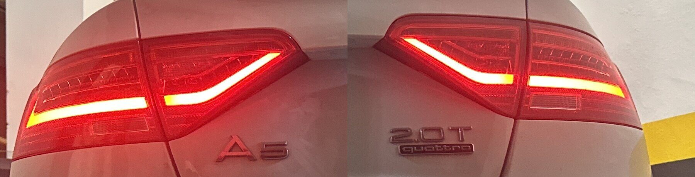
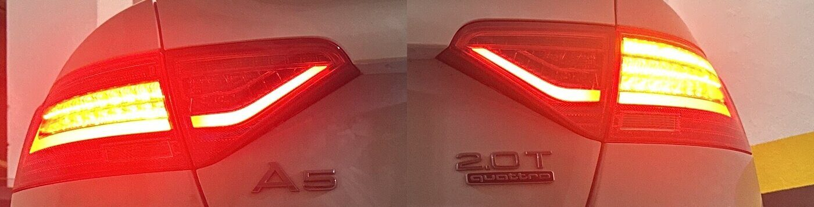
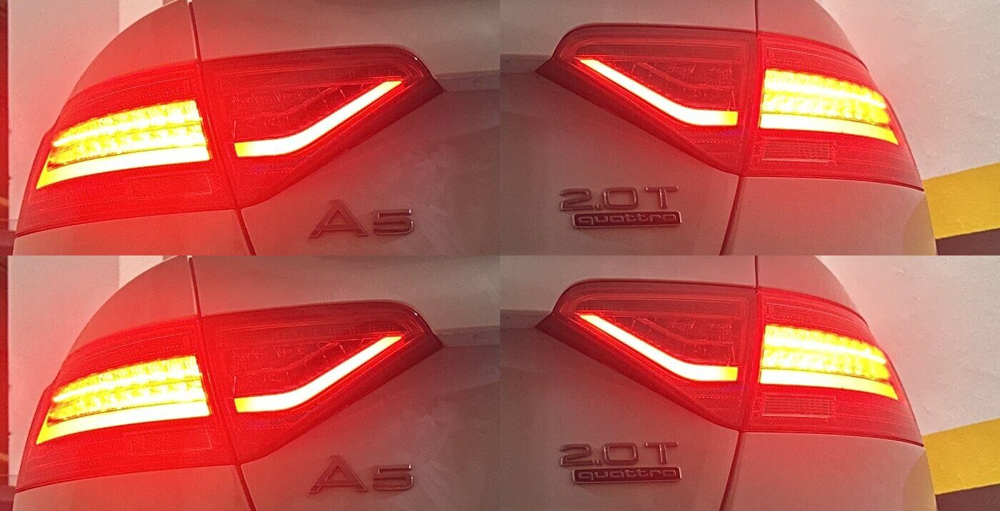

# Audi A5 8T facelift: US tail lights → EU tail lights (wiring + module 46 coding)

A US-market 2015 Audi A5 Coupé (8T facelift, B8.5) was fitted with European LED tail lights so the car has amber rear turn signals and a rear fog light. This page records what was plugged in, which adaptation channels in the comfort module were changed, the values before and after, and how the values were found.

Everything here was measured on one car. Read your own values and save them before you change anything.

## The car and the parts

| | |
|---|---|
| Car | 2015 Audi A5 Coupé 2.0 TFSI quattro, US market, factory LED tail lights |
| Module | 46 Central Convenience (J393), `8K0 907 064 KM`, BCM2 2.0, H15 0711 |
| EU outer lamps (fender) | `8T0 945 095 H` left, `8T0 945 096 H` right, marked ECE |
| EU inner lamps (trunk lid) | `8T0 945 093 C` left, `8T0 945 094 C` right |
| US lamps removed | `...095 J / 096 J` outer, `...093 D / 094 D` inner, marked SAE |

The EU lamps came from a breaker with the connector pigtails cut from the donor car.

## The symptom after fitting the EU lamps

US lamps use the same red element for brake and turn. EU lamps have a separate amber turn strip. With the EU lamps on US coding:

- pressing the brake also lit the amber turn strips,
- the turn signal and hazards also flashed part of the red brake LEDs.

The module needs to be told that brake and turn are now separate elements.

## Wiring

No new wires were run on this car.

- The car-side connector on the outer lamp is grey, `4H0 973 713 B`. The EU lamp takes the green one, `4H0 973 713 C`. They are the same connector family with different keying, so the grey plug does not fit the EU lamp properly.
- The wire colours on the donor pigtail matched the wire colours on the car harness, on both the outer and the inner lamps. The EU pigtails were spliced on colour to colour.
- The inner lamp has 4 wires on both the car and the EU pigtail.

| EU connector (green) | US connector (grey) |
|---|---|
|  |  |

Cut the car-side connector off close to the plug and leave a few centimetres of wire on it, so the original can be soldered back. Solder and heat-shrink the joints.

## Coding: module 46, adaptation channels

Access: module 46 → Security Access `16017` → Adaptation. The diagnostic tool's own channel list does not show these channels. Type the channel number by hand.

Odd channels are the left side, even channels the right. The right-side value is the left-side value plus 32.

| Channel (L / R) | What it drives on the EU lamps | US value (before) | EU value (after) |
|---|---|---|---|
| 195 / 196 | outer lamp: small block of brake LEDs | 134 / 166 | **132 / 164** |
| 197 / 198 | outer lamp: main rows of brake LEDs | 6 / 38 | **4 / 36** |
| 199 / 200 | outer lamp: amber turn strip (top) | 6 / 38 | **12 / 44** |
| 201 / 202 | inner lamp: amber turn strip | 134 / 166 | **140 / 172** |
| 203 / 204 | outer lamp: tail strip | 30721 / 30753 | unchanged |
| 207 / 208 | inner lamp: tail strip | 51201 / 51233 | unchanged |
| 205 / 206 | not identified | 13 / 45 | unchanged |
| 209 / 210 | not identified | 73 / 105 | unchanged |

The function code sits in the low bits of the value:

| Code | Function |
|---|---|
| 4 | brake only |
| 6 | brake + turn on one element (US) |
| 12 | turn only |

So the change on every channel is the same idea: `6 → 4` where the wire feeds brake LEDs, `6 → 12` where it feeds the amber strip. Channels 195 and 201 carry an extra `+128`, which was kept.

## Result

Tail lights, both sides:

Brake with the left side recoded and the right side still on US values. The right lamp lights its amber strip at the top, the left one does not:

Brake after recoding both sides (two shots):

Hazards after recoding, a burst of ten frames. Only the amber strips flash, on the outer and the inner lamps. The brake rows stay dark:

Rear fog off and on. It worked with no coding and no extra wire on this car. The light switch already had the rear fog position and the cluster shows the indicator:

What each lamp does now:

| Function | Outer lamp | Inner lamp |
|---|---|---|
| Tail | red strip | red strip |
| Brake | rows of red LEDs | none |
| Turn / hazard | amber strip | amber strip |
| Rear fog | none | 3 bright LEDs |
| Reverse | white, bottom | none |

The inner lamps do not light on brake. The inner lamp has four wires: ground, tail, turn and fog, so there is no wire left for a brake element. A test of channel 207 with `51205` (the value a facelift Q5 uses for "tail that brightens on brake") made no visible difference, and values from `51209` upward switched the tail strip off.

## How the values were found

The forum threads for this conversion give values for other cars or other lamp generations, and they disagree with each other. The channel map above was built on the car.

1. **Backup first.** Channels 179–247 were read one by one and written to a log file before any change.
2. **Use Test, not Save.** The adaptation screen has a Test button that applies a value until the channel is read again. Nothing is stored. Every candidate value was tried this way first.
3. **Switch one channel off and see what goes dark.** Testing a channel with `0` while the tail lights, the brake or the hazards are on shows which LED group that channel feeds.
4. **Compare left against right.** Only the left channel was changed while the right stayed on US values. Both lamps are in the same photo, so the unchanged side is the reference.
5. **A phone as the eyes.** One person was working alone, so nobody could press the brake and look at the lamps at the same time. A phone on the floor behind the car streamed its camera to the laptop. An AI coding assistant (Claude Code) drove the diagnostic tool on a second laptop by remote control, set a test value, asked by voice for "brake" or "hazards", took the photos and compared them. The owner confirmed colours by eye when the camera could not.
6. **Save, then read back.** Each accepted value was saved alone and the channel was read again to confirm it.

### What went wrong, so you can avoid it

- **The camera lies about LED colour.** Bright red LEDs blow out to orange in video frames, so red brake LEDs and the amber strip looked the same. Two wrong conclusions came from that. Full-resolution stills cropped to each lamp fixed it: the LED groups sit in different places, so position tells them apart even when colour does not.
- **Low battery voltage breaks the session.** With the ignition on and the lights on for a long time the battery dropped to 10.8 V. The diagnostic adapter dropped off USB and the module stopped answering. Run the engine or connect a charger.
- **A batch script wrote values to the wrong channels.** After a dropped connection the tool's channel field no longer accepted the typed number, and a scripted "type channel, type value, save" wrote garbage into about fifteen channels, including the tail light ones. The backup from step 1 restored all of them. Write one channel at a time, and check the channel number and the stored value on screen after each write.
- **Without the ignition on the brake lights do not work**, which looks exactly like a coding fault.

## Sources that helped

- [AudiWorld: post-facelift European spec tail lights coding for Q5](https://www.audiworld.com/forums/q5-sq5-mki-8r-discussion-129/post-facelift-european-spec-tail-lights-coding-q5-part-numbers-2883472/) (same module family, different channel layout)
- [motor-talk: US-Blinker auf EU-Blinker umcodieren](https://www.motor-talk.de/forum/us-blinker-auf-eu-blinker-umcodieren-apk-181-255-t3742740.html) (login 16017, channels 191–212)
- [a5oc: looking for standard VCDS codes for tail lights A5 2015](https://www.a5oc.com/threads/looking-for-standart-vcds-codes-for-tail-lights-a5-2015.147881/)
- [Audizine: USDM tail lamps conversion](https://audizine.com/threads/usdm-tail-lamps-conversion.937109/)

## Disclaimer

This is a record of one conversion, shared as is. Wrong adaptation values can switch lights off or leave them on. Check every light before you drive, and check what your local inspection requires.
