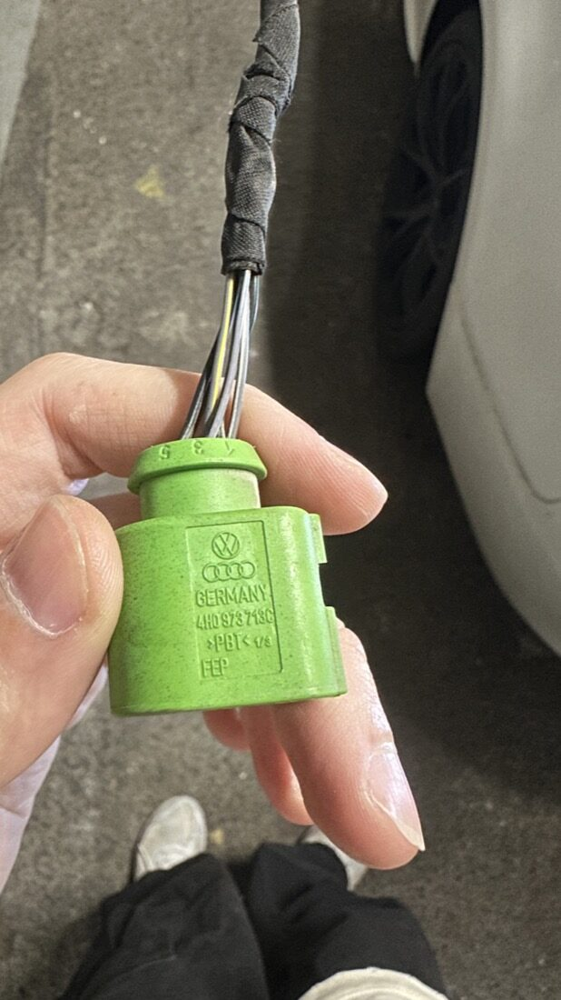
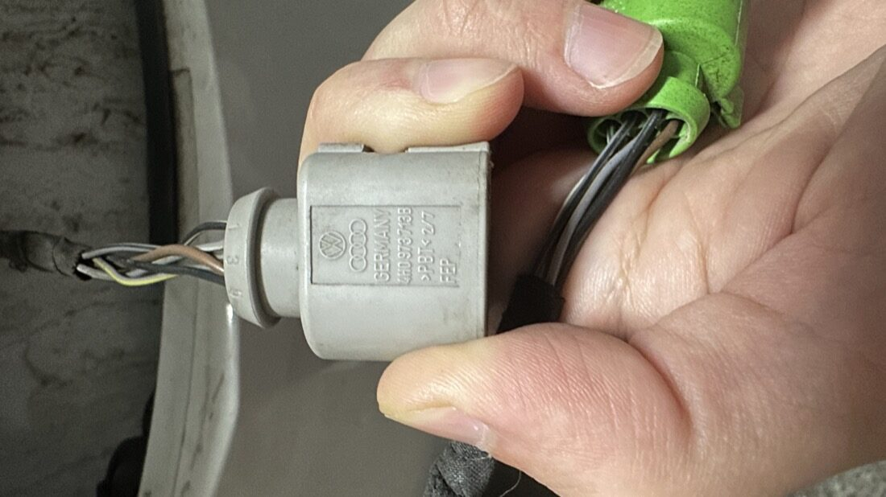
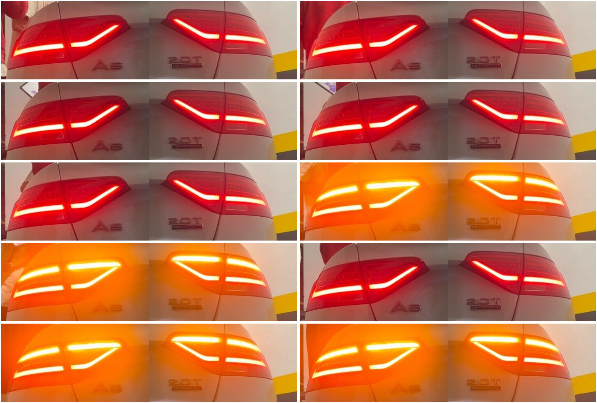
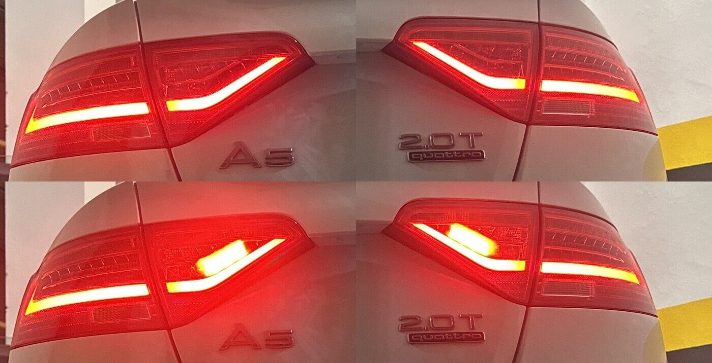

# Audi A5 8T facelift: US → EU tail lights

How European LED tail lights were fitted and coded on a US-market Audi A5 (8T facelift, B8.5), so the car has amber rear turn signals and a rear fog light. Includes the values that work, the values that looked right and were rejected by the module, and how to tell the difference.

## Short version

1. Fit the EU lamps. Splice the EU connector pigtails onto the car harness, colour to colour. No new wires were needed on this car.
2. In module 46 (Central Convenience, J393), Security Access `16017`, set eight adaptation channels to the **factory European values**:

| Channel (left / right) | US value (factory) | EU value (factory) | What it drives on the EU lamps |
|---|---|---|---|
| 195 / 196 | 134 / 166 | **133 / 165** | outer lamp: small block of brake LEDs |
| 197 / 198 | 6 / 38 | **5 / 37** | outer lamp: main rows of brake LEDs |
| 199 / 200 | 6 / 38 | **12 / 44** | outer lamp: amber turn strip |
| 201 / 202 | 134 / 166 | **12 / 44** | inner lamp: amber turn strip |

3. Let the car go to sleep (locked, key away, about 3 minutes), wake it, and read the fault memory of module 46. If `03389 - Data Set Implausible` is there, the module has rejected the set. See [The trap](#the-trap-03389-data-set-implausible).

> **How far this is verified.** Module 46 on this car is `8K0 907 064 KM`, BCM2 2.0, H15 0711. With the values above, tail, brake, turn, hazards and rear fog all work as they should, the module was put to sleep and woken once, and its fault memory shows no `03389`. That is one car and one sleep cycle so far. Read and save your own values before you change anything.

## Contents

- [The car and the parts](#the-car-and-the-parts)
- [The symptom](#the-symptom)
- [Wiring](#wiring)
- [Coding](#coding)
- [The trap: 03389 Data Set Implausible](#the-trap-03389-data-set-implausible)
- [What was tried, in order](#what-was-tried-in-order)
- [Result](#result)
- [Method: a phone as the eyes](#method-a-phone-as-the-eyes)
- [Lessons](#lessons)
- [Sources](#sources)

## The car and the parts

| | |
|---|---|
| Car | 2015 Audi A5 Coupé 2.0 TFSI quattro, US market, factory LED tail lights |
| Module | 46 Central Convenience (J393), `8K0 907 064 KM`, BCM2 2.0, H15 0711 |
| Module long coding | `0106069A00FA400582B000320000000F` (not changed) |
| EU outer lamps (fender) | `8T0 945 095 H` left, `8T0 945 096 H` right, marked ECE |
| EU inner lamps (trunk lid) | `8T0 945 093 C` left, `8T0 945 094 C` right |
| US lamps removed | `...095 J / 096 J` outer, `...093 D / 094 D` inner, marked SAE |
| Tool | a VCDS-compatible clone with adaptation access; no VCP, no ODIS |

The suffix tells the market: `H` and `C` are European, `J` and `D` are North American. The housing also carries an `ECE` or `SAE` mark. The EU lamps came from a breaker, with the connector pigtails cut from the donor car.

## The symptom

US lamps use one red element for both brake and turn. EU lamps have a separate amber turn strip. With EU lamps on US coding:

- pressing the brake also lit the amber turn strips,
- the turn signal and the hazards also flashed part of the red brake LEDs.

In this photo the left lamp is already recoded and the right lamp is still on US values, so it lights its amber strip (top row) on brake:

## Wiring

No new wires were run on this car.

- The car-side connector on the outer lamp is grey, `4H0 973 713 B`. The EU lamp takes the green one, `4H0 973 713 C`. Same connector family, different keying.
- The wire colours on the donor pigtails matched the wire colours on the car harness, on the outer and the inner lamps. The pigtails were spliced on colour to colour.
- The inner lamp has 4 wires on both the car and the EU pigtail: ground, tail, turn, rear fog.

| EU connector (green, `...713 C`) | US connector (grey, `...713 B`) |
|---|---|
|  |  |

Tips:

- Cut the car-side connector close to the plug and leave a few centimetres of wire on it, so the original can be soldered back.
- Before cutting, probe each car-side wire with a multimeter (tail on, brake pressed, turn signal on) and note colour → function. If the colours on your pigtail do not match, connect by function.
- Solder and heat-shrink the joints.

## Coding

Route: module 46 → Security Access `16017` → Adaptation. The tool's drop-down list does not show these channels, so type the channel number by hand. Odd channels are the left side, even channels the right side. The right-side value is the left-side value plus 32.

### Channel map on this car

| Channel (L / R) | Output on the EU lamps | US factory | EU factory | Changed here |
|---|---|---|---|---|
| 183 | bulb monitoring mask | 65535 | 65532 | no |
| 195 / 196 | outer: small block of brake LEDs | 134 / 166 | 133 / 165 | **yes** |
| 197 / 198 | outer: main rows of brake LEDs | 6 / 38 | 5 / 37 | **yes** |
| 199 / 200 | outer: amber turn strip | 6 / 38 | 12 / 44 | **yes** |
| 201 / 202 | inner: amber turn strip | 134 / 166 | 12 / 44 | **yes** |
| 203 / 204 | outer: tail strip | 30721 / 30753 | 30722 / 30754 | no |
| 205 / 206 | reverse | 13 / 45 | 13 / 45 | same |
| 207 / 208 | inner: tail strip | 51201 / 51233 | 51201 / 51233 | same |
| 209 / 210 | rear fog | 73 / 105 | 73 / 105 | same |
| 211 / 212 | plate light / third brake light | 51214 / 51215 | 51214 / 51215 | same |
| 213 | looks like a data-set variant ID | 13109 | 19512 | no |

The "EU factory" column is a factory adaptation map of a European A5 Sportback with facelift LED lamps, posted on [audi4ever](https://www.audi4ever.com/forum/thema/64611-a4-a5-q5-komfortsteuergerät-anpassung-der-rückleuchten/). The "US factory" column was read from this car before any change. All other channels from 181 to 214 are identical in both.

Only the eight brake and turn channels were changed. Channels 183, 203/204 and 213 were left on US values and the lights work. What changing 213 does is not documented anywhere, so it was not touched.

### What the values mean

The function is in the low bits of the value. These codes come from forum tables and from testing on this car:

| Code | Function |
|---|---|
| 1 | tail |
| 4 | tail and brake on one LED group (not "brake only") |
| 5 | brake only |
| 6 | brake and turn on one element (North America) |
| 9 | rear fog |
| 12 | turn |
| 13 | reverse |
| 14 / 15 | plate light / third brake light |

`+32` marks the right side. `+128` appears in factory sets only on the brake outputs 195/196 (133, 134). The high byte, where present, is a brightness value (for example `51201` = `0xC8 01` = tail at level 200).

## The trap: 03389 Data Set Implausible

The module accepts any value you save. The lights then follow that value straight away, so a wrong set looks finished. The check comes later:

- The module validates the whole light data set when it starts up after the car has been asleep. Switching the ignition off and on again within a few seconds does not count.
- If the set breaks its rules, it logs `03389 - Data Set Implausible` in module 46, turns on the bulb warning in the cluster and uses a built-in failsafe light set. In that state brake and turn share LEDs again, exactly like US coding. It looks as if the coding "reset itself".
- The stored values are still the ones you wrote. Only the behaviour changes.
- The fault comes back as soon as it is cleared, for as long as the set is wrong. After restoring a valid set, the fault needs one real restart of the module and then a manual clear.

How to test a set properly:

1. Write the values, read each one back.
2. Clear the fault memory of module 46.
3. Stop the engine, take the key out, lock the car, keep the key away from it, wait about 3 minutes.
4. Switch the ignition on, wait a minute, check the cluster and read the fault memory of module 46.

On this car the first restart with a wrong set happened while cranking on a weak battery, and that time the module also overwrote about twenty channels with its failsafe numbers: 195–197 and 199–202 became `10248 / 10280`, 203–210 became `0`, 212 = `15`, 213 = `12336`, 214 = `1`, 230–237 = `2771, 2772, 2901, 2902, 3532, 3533, 3554, 3555`, 238–245 = `0`. A [Ross-Tech thread](https://forums.ross-tech.com/index.php?threads/9240/) shows the same numbers on another A5. If you see these values, restore every channel from your backup, including 213, 214 and 230–245.

## What was tried, in order

All sets below made the lights behave correctly right after saving. The last column is what the module did at its next real restart.

| # | 195/196 | 197/198 | 199/200 | 201/202 | After restart |
|---|---|---|---|---|---|
| US factory | 134/166 | 6/38 | 6/38 | 134/166 | accepted |
| 1 | 132/164 | 4/36 | 12/44 | 140/172 | **rejected**, 03389 |
| 2 | 4/36 | 4/36 | 12/44 | 12/44 | **rejected**, 03389 |
| 3 | 134/166 | 134/38 | 6/38 | 134/166 | **rejected**, 03389 |
| 4 | 134/166 | 6/38 | 6/38 | 140/166 | accepted |
| EU factory | 133/165 | 5/37 | 12/44 | 12/44 | **accepted** |

What this shows:

- It is not a checksum over the data set. Set 4 changed one channel and was accepted.
- The values in sets 1 and 2 were worked out by logic ("6 is brake plus turn, so 4 must be brake only"). They are not values the factory uses. Code 4 without a brightness byte and the combinations 132 and 140 do not appear in any factory map that could be found.
- Set 3 changed one channel to a value the neighbouring channel already uses, and was still rejected. The module has rules about which function may sit on which output.
- The factory EU values are the ones to use. Guessing by logic costs a restart cycle per attempt.

Sets 1 to 3 also produced a wrong conclusion along the way: after three rejections in a row it looked as if the module refused any edit, and that only ODIS or VCP could write the set. Set 4 disproved that.

## Result

| Function | Outer lamp (fender) | Inner lamp (trunk lid) |
|---|---|---|
| Tail | red strip | red strip |
| Brake | rows of red LEDs | none |
| Turn / hazard | amber strip | amber strip |
| Rear fog | none | 3 bright LEDs |
| Reverse | white, bottom | none |

The photos below were taken during testing with set 1. The lights look the same with the final values.

Tail lights:

Brake. Brake rows lit, amber strips dark:

Hazards, a burst of ten frames. Only the amber strips flash, on the outer and the inner lamps:

Rear fog off (top) and on (bottom). It worked with no coding and no extra wire on this car. The light switch already had the rear fog position and the cluster shows the indicator:

A phone camera blows bright red LEDs out to orange and yellow. In real life the brake rows and the tail strips are red, and only the top strips are amber.

The inner lamps do not light on brake. The inner lamp has four wires (ground, tail, turn, fog), so there is no wire for a brake element. Brake light comes from the two outer lamps and the third brake light.

## Method: a phone as the eyes

The owner was alone, and nobody can press the brake and look at the lamps at the same time.

- A phone on the floor behind the car sent its camera picture to a laptop.
- An AI coding assistant (Claude Code) drove the diagnostic tool on a second laptop by remote control. It set a value, asked the owner for "brake" or "hazards", took the photos and compared them. The owner confirmed colours by eye where the camera could not.
- Channels 179–247 were read and saved to a file before the first change. That backup was used three times.
- To find which output feeds which LED group, a channel was tested with `0` while the lights were on, and the photo showed what went dark. Only the left channel was changed each time, so the right lamp in the same photo was the reference.
- Later the remote clicking was replaced by a small script that checks which window of the tool is on top before every action, refuses to act if a popup is open, reads the value back after each write, and stops on any mismatch.

## Lessons

- **Use factory values for the target market.** Working out function codes by logic gave sets that lit the lamps correctly and were still rejected.
- **A set is not done until it survives a sleep and wake of the car.** Check module 46 for `03389` after that.
- **Back up every channel before the first change**, including the service channels above 212.
- **Keep the battery up.** With ignition and lights on for hours the battery fell to 10.8 V. The diagnostic adapter dropped off USB, the module stopped answering, and the first failsafe overwrite happened during a start on low voltage. Use a charger.
- **Do not trust video frames for LED colour.** Red brake LEDs and the amber strip looked the same. Full-resolution stills cropped to each lamp fixed it: the LED groups sit in different places, so position tells them apart.
- **Blind scripted clicking is dangerous.** A click sequence that assumed the wrong screen opened a different module, and a log window covered the Test and Save buttons so several writes silently did nothing. Check the screen before each action.
- **The first read after opening the adaptation screen can show a stale value.** Read the channel twice.
- **Brake lights need the ignition on.** With the ignition off they stay dark, which looks like a coding fault.

## If the module still rejects the set

Reports from other owners suggest module versions differ. If the factory EU values are rejected on your car:

- VCP (VAG CAN Pro) has a guided function to recode BCM2 between US and EU LED or bulb lamps, and parameter files for 8K0 907 064. Check first that a file exists for your module index. For late K-index modules there are reports of no matching file.
- A dealer's online system normally only offers the data set that belongs to the car's market.
- The Kufatec looms with a coding dongle for "LED US to LED facelift EU" are listed for cars up to model year 2011.

## Sources

- [audi4ever: A4 A5 Q5 Komfortsteuergerät, Anpassung der Rückleuchten](https://www.audi4ever.com/forum/thema/64611-a4-a5-q5-komfortsteuergerät-anpassung-der-rückleuchten/) (factory EU adaptation maps, including A5 Sportback with facelift LED)
- [motor-talk: FL-Rückleuchtenumbau geschafft](https://www.motor-talk.de/forum/fl-rueckleuchtenumbau-geschafft-t3793965.html) (long thread on facelift lamp coding and "Datensatz unplausibel")
- [Ross-Tech: Audi A5 Coupe RoW tail LED retrofit failure](https://forums.ross-tech.com/index.php?threads/9240/) (03389 and the failsafe numbers)
- [Ross-Tech: 8K0 907 064 C DataSet Implausible (03389)](https://forums.ross-tech.com/index.php?threads/41775/)
- [motor-talk: US-Blinker auf EU-Blinker umcodieren](https://www.motor-talk.de/forum/us-blinker-auf-eu-blinker-umcodieren-apk-181-255-t3742740.html) (login 16017, channels 191–212)
- [AudiWorld: post-facelift European spec tail lights coding for Q5](https://www.audiworld.com/forums/q5-sq5-mki-8r-discussion-129/post-facelift-european-spec-tail-lights-coding-q5-part-numbers-2883472/)

## Disclaimer

This is a record of one conversion, shared as is. Wrong adaptation values can switch lights off or leave them on. Check every light before you drive, and check what your local inspection requires.
